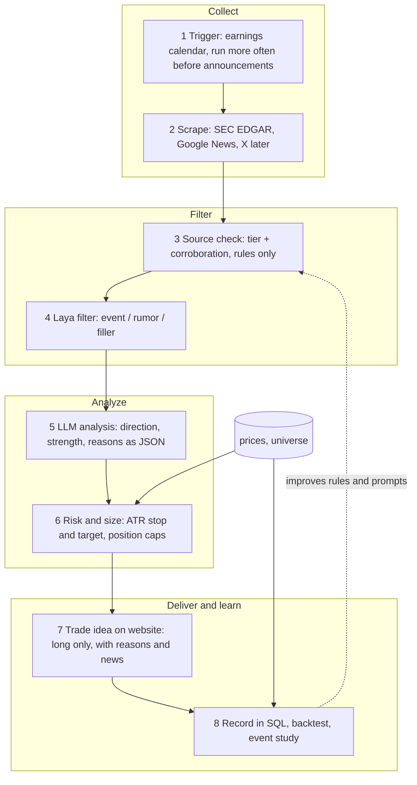

# PlanWise AI: short-term stock pipeline, spec v2

Written 2026-10-16; updated 2026-10-18 (see section 0 for what changed). Audience: the next Claude session that continues this work. Read this file fully, then `OVERVIEW.md`, `frontend/AGENTS.md`, `Backend/README.md`.

Status words used below: **Done** (built and checked), **Built, unvalidated** (works but accuracy not proven), **Todo**, **Proposal** (my suggestion, the user has not approved it), **Decision needed** (blocked on the user).

---

## 0. Changes since the first version (session of 2026-10-17 to 2026-10-18)

Read this first; the rest of the file was updated to match.

**Decisions made by the user in this session**

- **No X / influencer data.** Dropped. The `SocialSentiment` panel therefore has no real feed behind it.
- **The LLM runs as Ollama on Kaggle** (model `qwen3:8b`). Decided on the assistant's recommendation: 8B at Q4 is about 5 to 6 GB and fits a T4.
- **SEC EDGAR and the earnings-date trigger:** the user said they will bring those in later. Do not start them unprompted.
- User also approved, in chat, once: restarting their backend on port 8000 (it was running old code), and writing the new Kaggle URL/token lines into `Backend/.env`.

**What was built**

| Item | State |
|---|---|
| `Backend/llm_server/server.py` | Token-protected gateway in front of Ollama (`/health`, `/chat`). Runs on Kaggle. |
| `Backend/pipeline/llm.py` | Stage 5. One call per recommended ticker, JSON schema enforced by Ollama (`format`), validated in code (confidence 0..1, cited ids must be in the input, a view needs a cited headline), one retry, every call logged in the new table `llm_analysis`. Display-only. |
| `Backend/experiments/kaggle_gateways.ipynb` | **One notebook that runs Laya (GPU 1) and Ollama (GPU 0) together**, two Cloudflare tunnels, **one shared random token**, prints four ready-to-paste `.env` lines. Re-running the launch cell first kills old servers so the printed token always matches. Generated from `laya_server/server.py` and `llm_server/server.py`. |
| `Backend/app/main.py` | `latest_llm()` adds an `llm` object to each item of `/api/recommendations` (direction, magnitude, confidence, reasons, caveats, cited headlines resolved to title/source/url). Was added by a parallel session; verified working. |
| Frontend | `LlmBlock` on each idea card ("AI reading of the news", badge "AI · Not validated", says it does not change the score). `SocialSentiment` now has a large **SAMPLE** watermark. `TopNews` subtitle now says prices are the last close and not a reaction to the headline, and that AI labels are not validated. |

**First real run (late evening of 2026-10-17):** `pipeline.llm` over all 42 distinct recommended tickers: 42 of 42 succeeded (44 rows in `llm_analysis` including 2 from the smoke test), average 8.8 s per ticker, results up 36 / down 2 / none 6. The web page showed the block on 20 of 20 cards for 1w.

**Problems found and NOT fixed (do these next)**

1. `ReasonText` in `IdeasView.tsx` labels every linked reference `[1]` (it numbers by position inside the sentence, not by headline), so three reasons citing three different headlines all show `[1]`. Ids the model mentions but did not list in `cited_news_ids` (for example `[4]`, `[11]`) appear as raw numbers with no link.
2. **Laya labels look wrong on clear cases.** For MA, "Stock Passes Buy Point Amid Powerful Move Higher" and "Could Be 32% Undervalued" were both labeled Bearish, while the LLM says Up. There is no ground truth yet; the hand-labeled file `to_label.csv` (T0) is what settles this.
3. **The LLM leans bullish** (36 of 42 up). Possible bias from words like "stock" in headlines, or from the selection (the ideas are already momentum names). Check on labeled data before trusting.
4. **Laya and the LLM are not chained yet.** `pipeline/llm.py` reads every headline with `rule_noise = 0`; it does not use Laya's filler/event result or source tiers (stages 3 and 4 are still Todo).
5. **Duplicate LLM-server files from a parallel session** are in the repo and overlap with the above: `llm_server/proxy.py`, `llm_server/build_notebook.py`, `experiments/ollama_server_kaggle.ipynb`, `experiments/llm_kaggle_one_cell.py`, `experiments/llm_server_kaggle.ipynb`. `Backend/README.md` also has two LLM sections ("LLM server" and "Kaggle gateways"). Pick one path (the one-notebook `kaggle_gateways.ipynb` is the tested one) and delete the rest. Note `llm_server/server.py` was edited by that session after the assistant first wrote it; `kaggle_gateways.ipynb` embeds the current version.
6. A test account `llmcheck@planwise.test` exists in `planwise.db` (created to view the UI). Delete it when done.

**State of the running things at the end of the session**

- Kaggle notebook `notebookdd09550bcb` (user's account) was importing `kaggle_gateways.ipynb` and had the launch cell running; the launch cell was started about 23:40 on 2026-10-17 and the links last at most about 11 hours, then they are dead. `Backend/.env` holds that run's `LLM_URL`, `LLM_TOKEN`, `LAYA_URL`, `LAYA_TOKEN` (stale after the session ends). **Stop the Kaggle session** when finished to save GPU hours.
- Backend: restarted on port 8000 by the assistant (background process of that session). PlanWise frontend: **port 3001**, not 3000 (3000 is the user's other project, Colony Bridge).
- Nothing is committed.

---

## 1. What this project is

A graduation project. A website that shows personalised **short-term stock ideas** for S&P 500 stocks, with the reasons and the news behind each idea. The short-term pipeline comes first; a long-term one comes later.

### Decisions already made by the user (do not re-open)

| Topic | Decision |
|---|---|
| Market | S&P 500 stocks only. No futures, no options. |
| Direction | **Long only.** No short ideas. (The user agreed to drop LONG/SHORT from the old diagram.) |
| Holding periods | 1 week, 1 month, 3 months (`1w`, `1m`, `3m`). |
| Where AI runs | **Never on the user's computer.** AI models run on Kaggle, exposed through a Cloudflare tunnel, and the backend calls them over HTTPS. |
| Order of work | Collect and archive news first, then filter, then LLM analysis, then backtest. |
| LLM runtime | **Ollama on Kaggle**, model `qwen3:8b`, behind the same kind of tunnel (decided 2026-10-17). |
| X / influencer data | **Dropped.** Not used. |
| SEC EDGAR, earnings trigger | User will bring these in later; deferred. |
| Language | The user writes Thai. Reply in plain Thai, no jargon without explanation. The website UI is English (the social-sentiment panel is Thai because the user's mockup was Thai). |

### Rules inherited from the repo (`frontend/AGENTS.md`, `OVERVIEW.md` section 7)

- Never invent balances, formulas, data sources or recommendation reasons. Every figure must be real or visibly labeled as example data.
- Treat anything marked *Usulan / TBD / Proposal* as unapproved. Do not silently turn it into a product decision.
- No payments, no trading, no bank connections.
- Never put secrets in frontend code.
- Keep the UI separate from data sources so mock data can be swapped for an API.
- Next.js here is v16 with breaking changes: read `frontend/node_modules/next/dist/docs/` before writing Next code.

---

## 2. Target pipeline

The user's own diagram (an Obsidian canvas) had these boxes: `AGENT.md` and `time trigger 30m before announce` feed `Scrape news (x, previous news, economic news, etc.) -> JSON output -> filter with JEV model or machine learning -> LLM analysis -> output long/short`.

**Key idea from the user:** the filter step answers "is this news real and from a credible origin?" and the LLM step answers "is it good or bad for the stock, and why?". News is trusted because an identifiable influential party (a company, a regulator, a named executive) said it first-hand, not because some unknown person repeated it.



### Stage table

| # | Stage | What it does | Uses AI | Status |
|---|---|---|---|---|
| 0 | Prices | S&P 500 list + 2 years of daily bars from yfinance, validated | no | **Done** (`pipeline/ingest.py`) |
| 1 | Trigger | Run scraping more often before each company's earnings date | no | Todo (deferred by the user) |
| 2 | Scrape | Google News RSS archive: **Done**. SEC EDGAR filings: Todo (deferred by the user). X / influential people: **dropped by the user** | no | Partly done |
| 3 | Source check | Source tier and number of independent sources per event | no | Todo |
| 4 | Laya filter | Classify each headline as concrete event / rumor / filler | Laya | **Built, unvalidated**, but asks the wrong question (see 4.4) |
| 5 | LLM analysis | Structured impact analysis of filtered news | LLM | **Built, unvalidated** (`pipeline/llm.py`, Ollama `qwen3:8b` on Kaggle); input is not yet filtered by stages 3 and 4 |
| 6 | Risk and size | Entry, stop, target from ATR; position size from the user's risk profile | no | **Done** (`pipeline/rank.py`, `app/main.py`) |
| 7 | Trade idea | Cards, Top news widget, news chips, LLM block on the website | no | **Done**; the Laya sentiment chip is from the wrong stage and the LLM block has a link-label bug (see section 0 and 3.4) |
| 8 | Record and test | Backtest, event study, calibration, log tokens/latency/errors | no | Todo |

---

## 3. Current state (what exists on disk)

Repo root: `/Users/fais/Desktop/SPECIAL_LAB_PROJECTS`. **Nothing has been committed.** `git status` shows `Backend/`, new frontend folders and edits as uncommitted. Do not commit unless the user asks.

### 3.1 Run it

```bash
# backend (the user's own command; it has no --reload, so restart it after editing app/main.py)
Backend/.venv/bin/uvicorn app.main:app --port 8000 --app-dir Backend
# frontend: PlanWise runs on port 3001 (port 3000 is the user's other project, Colony Bridge)
cd frontend && npm run dev
```

Daily data refresh, in this order (run from `Backend/`):

```bash
.venv/bin/python -m pipeline.ingest              # S&P 500 list + prices (~90 s)
.venv/bin/python -m pipeline.rank                # scores, writes recommendations (REPLACES all rows)
.venv/bin/python -m pipeline.news                # headlines for current ideas; add --all for all 503 (~9 min)
.venv/bin/python -m pipeline.analyze             # Laya scores via Kaggle; needs LAYA_URL and LAYA_TOKEN in Backend/.env
.venv/bin/python -m pipeline.llm                 # LLM analysis via Kaggle (~9 s per ticker, ~6 min for 42); needs LLM_URL and LLM_TOKEN
```

`rank` deletes and rebuilds `recommendations`, so `news`, `analyze` and `llm` must run after it every time (`llm_analysis` keeps old rows; the API shows the newest successful row per ticker).

The frontend proxies `/api/*` to the backend with a Next `rewrites()` rule in `frontend/next.config.ts`. **The rewrite target is fixed at build time** from `BACKEND_URL` (default `http://127.0.0.1:8000`); when testing a build against another port, rebuild with that env var.

### 3.2 Backend files

| File | Purpose |
|---|---|
| `app/main.py` | FastAPI: auth (scrypt, httpOnly `session` cookie), `/api/profile`, `/api/recommendations?horizon=`, `/api/top-news`, `/api/me`. Creates tables and seeds mock rows if `recommendations` is empty. |
| `app/seed.py` | 12 example ideas. Only used when the table is empty. |
| `pipeline/ingest.py` | Steps 0: universe from Wikipedia, prices from yfinance, validation, `data_issues` log. |
| `pipeline/rank.py` | Indicators (returns, SMA 50/200, volume ratio, ATR14), per-horizon score, ATR stop/target, reasons built only from computed numbers. |
| `pipeline/news.py` | Google News RSS per ticker. Appends every relevant headline to `news_items`. Keyword filter `NOISE` sets `rule_noise`. Writes the top 3 non-noise to `recommendations.news`. |
| `pipeline/analyze.py` | Calls the Laya server, stores `news_scores`, refreshes card news (demotes likely filler, never hides it). |
| `pipeline/llm.py` | Stage 5, see section 0. Constants `PROMPT_VERSION = "v1"`, `MAX_HEADLINES = 15`. Reads `LLM_URL`, `LLM_TOKEN` from `.env`. |
| `llm_server/server.py` | Gateway that runs **on Kaggle** in front of Ollama: `/health`, `/chat` (Bearer token), forces `stream: false` and `think: false`. |
| `laya_server/server.py` | The server that runs **on Kaggle**: FastAPI `/health`, `/analyze` (Bearer token). Source of truth for the Kaggle notebook. |
| `experiments/laya_eval.ipynb` | Kaggle experiment A (Laya vs FinBERT). |
| `experiments/kaggle_gateways.ipynb` | **Use this one.** Runs Laya and the LLM gateway in one session (see section 0). Cells: setup (zstd, pciutils, Ollama, cloudflared), write server files, launch. |
| `experiments/laya_server_kaggle.ipynb` | Older Laya-only notebook. Superseded by `kaggle_gateways.ipynb`. |
| `experiments/news_items.csv` | Export of the 12,801 archived headlines (git-ignored). |
| `experiments/to_label.csv` | 200 random non-noise headlines with empty `gold_sentiment` / `gold_kind` columns, for the user to label by hand (git-ignored). |
| `.env` | Secrets, git-ignored. Contains `ollama_key` and the `LLM_URL`, `LLM_TOKEN`, `LAYA_URL`, `LAYA_TOKEN` of the last Kaggle run (they die when that session stops; one token is shared by both URLs). Never print its contents. |

Python venv: `Backend/.venv` (Python 3.14). Installed: fastapi, uvicorn, yfinance, pandas, lxml, requests. **Do not install torch, transformers or laya locally.**

### 3.3 Database (`Backend/planwise.db`, SQLite, git-ignored)

| Table | Rows now | Notes |
|---|---|---|
| `users`, `sessions`, `risk_profiles` | 4 users | Test accounts only, including `llmcheck@planwise.test` created on 2026-10-17 to view the UI. `risk_profiles.horizon` is `1w`/`1m`/`3m`; `risk_level` is derived. |
| `universe` | 503 | GOOG and GOOGL both present. `sector` maps GICS to the form's keys (`tech`, `healthcare`, `finance`, `energy`, `consumer`, `other`). |
| `prices` | 250,840 | 502 tickers, 2024-10-14 to 2026-10-14. VYLR rejected (10 bars). |
| `data_issues` | 4 | 3 `suspect_jump` (BE, ECHO, MRNA), 1 `too_few_rows`. |
| `recommendations` | 60 | 20 per horizon, real (`is_example = 0`). `news` is a JSON list of up to 3 items. |
| `news_items` | 12,801 | Unique on `(ticker, url)`. Columns: `published_at`, `first_seen_at`, `last_seen_at`, `rule_noise`. Covers 2026-10-09 to 2026-10-16 only (Google News keeps about 7 days). |
| `llm_analysis` | 44 | 42 tickers from the first full run plus 2 smoke-test rows (A, AAPL). All succeeded. Columns: see 4.5. |
| `news_scores` | 1,217 | Laya output for headlines of recommended tickers. Primary key `(news_id, model)`. Holds `sentiment`, three probabilities, `kind`, `p_filler`. |

### 3.4 Frontend

`frontend/src/`: `app/login`, `app/onboarding` (5 questions), `(app)/page.tsx` (Trade ideas home, `?h=1w|1m|3m`), `components/ideas/{IdeasView,TopNews,SentimentBadge,SocialSentiment}.tsx`, `lib/{session,recommendations}.ts`. The `(app)/layout.tsx` redirects to `/login` or `/onboarding`.

Things in the UI to know about:

- **`SentimentBadge` shows "AI · Bullish/Bearish/Neutral" from Laya.** Under the new design, direction is the LLM's job, so this chip comes from the wrong stage. Treat it as a temporary baseline and replace it (task T6).
- **`SocialSentiment.tsx` is a pure mockup** (Thai text, three example scenarios, accounts named `*_example`, a "ตัวอย่าง" badge). It does not change any real score. X data was dropped by the user, so decide: keep it as a labeled design mock or remove it.
- **LLM block** (`LlmBlock` in `IdeasView.tsx`) is live; see section 0 for its known bug.
- **`SocialSentiment` now carries a SAMPLE watermark** and its "Total score" does not match the real card score. With X dropped there is no source for it; removing it is still the cleaner option.
- `components/dashboard/DashboardView.tsx` and its mock data are unused now. Safe to delete.
- Banners tell the user the ideas are rule-based, not backtested, and not investment advice. Keep this honesty.

### 3.5 How scoring works today (`pipeline/rank.py`)

Percentile ranks of momentum, volume ratio and low volatility, combined with per-horizon weights; filters: liquidity at least $50M per day, price above SMA50 (and SMA200 for 1m/3m), not more than 25% above SMA50, at most 4 per GICS sector. Stop and target are ATR multiples: 1w 2x/3x, 1m 3x/5x, 3m 4.5x/8x. **The weights and multiples are untested guesses until a backtest exists.** Position size in the API is `min(cap by risk level, loss budget / stop distance)`.

---

## 4. Stage specs for the next session

### 4.1 Stage 1: Trigger

Goal: scrape more often in the days before a company reports earnings (the user's "time trigger 30m before announce").

- Source of earnings dates: yfinance calendar data (verify what it returns for S&P 500 names before relying on it).
- Output: table `earnings_calendar(ticker, date, source, fetched_at)`; a small scheduler script that runs `pipeline.news` for tickers with earnings in the next N days at a shorter interval.
- Installing a cron job or launchd agent changes the user's machine. **Ask first** and show the exact entry.
- Acceptance: for a ticker with earnings tomorrow, headlines are fetched at the shorter interval; others stay on the normal schedule.

### 4.2 Stage 2: Scrape

**Google News** (Done). Known limits: unofficial RSS, about 7 days of history, redirect URLs, no images, lag of minutes to hours that has **not been measured yet** (the first run backfilled a week, so the lag number from it is meaningless; measure it from later runs using `first_seen_at - published_at`). Archive grows only if `news` runs regularly.

**SEC EDGAR** (Todo, `pipeline/sec.py`). Primary-source filings are the most credible "influential party said it themselves" signal and are free.

- Map ticker to CIK with SEC's `company_tickers.json`; pull recent filings per CIK. SEC requires a descriptive `User-Agent` with contact info and asks for at most about 10 requests per second. Verify the current endpoints and policy at implementation time; do not rely on this memory.
- Store 8-K items and Form 4 (insider trades) as rows in `news_items` with `source = 'SEC EDGAR'`, `url` = the filing, title like `8-K: <item description>`. Ask the user for a real contact email for the header; do not invent one.
- Acceptance: for 5 sample tickers, last 30 days of filings appear in `news_items` and the cards.

**X / influential people: dropped by the user (2026-10-17).** Do not build it.

### 4.3 Stage 3: Source check (rules only, no AI)

Purpose: decide "how much do we believe this" from where it came from.

Add columns to `news_items`: `source_tier INTEGER`, `event_key TEXT`, `corroboration_count INTEGER`.

- **Source tiers (Proposal, needs user review):** tier 1 primary (SEC EDGAR, company press releases on Business Wire / PR Newswire / GlobeNewswire); tier 2 major outlets (Reuters, Bloomberg, WSJ, AP, CNBC, FT, Barron's); tier 3 general finance sites (Yahoo Finance, MarketWatch, Seeking Alpha, Motley Fool, Benzinga, Zacks, TipRanks); tier 4 aggregators and auto-generated pages (MarketBeat, Simply Wall St and similar); unknown sources default to tier 4. Keep the list in a config table or file, not hard-coded.
- **Corroboration (Proposal):** group headlines for the same ticker within 48 hours whose normalised title tokens overlap strongly (start with Jaccard 0.6, tune by eye on real data); `corroboration_count` = number of distinct sources in the group.
- Acceptance: a unit-style script prints, for 20 random headlines, the tier and group size so the user can eyeball them; no AI involved.

### 4.4 Stage 4: Laya filter

What exists: Laya (`convaiinnovations/laya`, English root checkpoint, an encoder "decision" model, not a generator) runs on Kaggle behind a Cloudflare quick tunnel. `laya_server/server.py` asks two choice questions per headline: `sentiment` (bearish/bullish/neutral) and `kind` (event/filler).

What must change (Todo):

1. **Remove sentiment from the Laya server's job.** Direction belongs to the LLM (stage 5). Keep the sentiment column only as a labeled baseline for comparison.
2. **Change `kind` to three options: `event` / `rumor` / `filler`.** `rumor` = reported speech without a named source ("reportedly", "sources say", analyst speculation). Criteria text must be rewritten and validated on the hand-labeled set. Regenerate the Kaggle notebook after editing `server.py`.
3. Feed stage 3 results into the decision: a headline is "credible" only if the rule signals and Laya agree; keep both columns so the rule can be audited.
4. `analyze.py` must store `p_event`, `p_rumor`, `p_filler`. The probabilities Laya returns are **not calibrated** (the library warns: "this checkpoint ships invalid temperatures"). Do not treat them as real probabilities until calibrated on labeled data.

**Starting and stopping the Kaggle servers (Laya + LLM together)**

1. In Kaggle (user's account `faislol`) use File, Import Notebook with `experiments/kaggle_gateways.ipynb`. The notebook `notebookdd09550bcb` currently holds it (importing replaced that notebook's cells). Settings: Accelerator **GPU T4 x2**, Internet On.
2. Run cell 1 (setup, a few minutes the first time), cell 2 (writes the server files), cell 3 (launch). Cell 3 **keeps running**; stopping it kills the links. Links live at most about 11 hours. If cell 3 is interrupted, just run it again: it kills the old servers first and prints a new token.
3. Cell 3 prints four lines: `LLM_URL`, `LLM_TOKEN`, `LAYA_URL`, `LAYA_TOKEN` (same token twice, two URLs). Put them in `Backend/.env`, replacing the old ones.
4. Verify: `curl <url>/health` (no auth) for both; a POST with the token must work and a wrong token must return 401. `pipeline.llm --limit 2` is the end-to-end test; `pipeline.analyze` may say "0 headlines to score" when everything is already scored, so test Laya by posting a couple of headlines to `/analyze`.
5. When finished, stop the session (power button). Kaggle also stops idle sessions by itself.

Gotchas learned: the notebook output sits in an iframe, so a browser tool cannot read it as text. Reading the token from a screenshot is risky (`I` and `l` look alike) and **guessing variants was blocked by the tool permission layer as credential guessing; do not try it.** Safe ways to move the values: the user copies the four lines, or the user downloads the notebook (File, Download Notebook) and you read the plain text from the `.ipynb` (this worked), or a zoomed screenshot when the token has no ambiguous characters. Ollama's installer needs `zstd` (`apt-get install zstd`, and `pciutils` for GPU detection) or it exits with an error; the notebook now installs both. Ollama and Laya fit together on T4 x2 (Ollama on GPU 0, Laya on GPU 1 via `CUDA_VISIBLE_DEVICES`); `ollama ps` showed `qwen3:8b` at 100% GPU. Adding an input dataset to a running notebook resets the session. "Run All" sometimes stops partway; run remaining cells by hand. The tunnel URLs and token change every start. The Laya model card says its own HTTP server has no auth by default; our wrapper adds a token and binds to 127.0.0.1 only.

### 4.5 Stage 5: LLM analysis

**Decided: Ollama on Kaggle, `qwen3:8b`** (the user's `colony-models-eval` notebook is their own unrelated work, do not edit it). Built as `llm_server/server.py` + `pipeline/llm.py`; the provider is a single configuration point (`LLM_URL`, `LLM_TOKEN` from `.env`, model name set in the notebook). The prompt (`SYSTEM` in `llm.py`) is version `v1`; bump `PROMPT_VERSION` when it changes. Prompt rules in v1: use only the supplied headlines, `direction: none` when unsupported, no prices or targets, reasons must rest on a cited headline id. Observed problems with the output are listed in section 0.

Input (target): only headlines (and filing excerpts) that passed stages 3 and 4, grouped per ticker, with ids. **Today's input is every `rule_noise = 0` headline of the ticker (newest 15), because stages 3 and 4 are not built.**

Output contract (Proposal), validated against a schema, stored per ticker and run:

```json
{
  "ticker": "PLTR",
  "direction": "up | down | none",
  "magnitude": "low | medium | high",
  "horizon": "1w | 1m | 3m | unclear",
  "confidence": 0.0,
  "reasons": ["short sentence tied to a cited headline"],
  "cited_news_ids": [123, 456],
  "caveats": ["what the headlines do not tell us"]
}
```

Rules for the prompt and code: use only the supplied text; if the news does not support a view return `direction: none`; never output prices or targets; reject and retry once on invalid JSON; record every call.

Table `llm_analysis(id, ticker, as_of, model, prompt_version, input_news_ids, output_json, tokens_in, tokens_out, latency_ms, error, created_at)` (the user's original diagram asked to save inputs, signals, tokens, time and errors).

Effect on the score: **display-only at first.** Later, allow at most a capped adjustment (the user's mockup used plus or minus 10) and only after stage 8 shows it helps.

### 4.6 Stage 6 and 7: risk and presentation (mostly done)

Changes still needed: replace the Laya sentiment chip with the LLM direction and a credibility badge (tier plus event/rumor), show `corroboration_count` on each headline, show the LLM reasons on the card. Keep AI-labeled items visibly marked as AI and "not validated" until stage 8 is done.

### 4.7 Stage 8: record and test

- Backtest the current rules with vectorbt (or a simple pandas loop) on the 2 years of prices, against buy-and-hold of the same universe. State the survivorship bias in the write-up: the universe is today's S&P 500 membership.
- Event study: do headlines classified as credible and bullish by the LLM precede better 1 to 5 day excess returns than the rest? News history is thin (one week); keep archiving so this becomes possible, or backfill from GDELT (not evaluated yet).
- Latency study: `first_seen_at - published_at` distribution per source; per-request latency of Laya and the LLM.
- Calibrate Laya probabilities on the hand-labeled set.
- Everything the pipeline decides must be reproducible from SQL.

---

## 5. Experiment results so far

All run on Kaggle (T4), 2026-10-16. Single run each, no confidence intervals.

**Experiment A: public labeled set** (`zeroshot/twitter-financial-news-sentiment`, validation split, 2,388 items, MIT license). Tweet-style text, not our headlines.

| Model | Accuracy | Macro F1 | Time per item |
|---|---|---|---|
| FinBERT (batched) | 0.725 | 0.668 | 2.7 ms |
| Laya English, no fine-tuning | 0.796 | 0.736 | 34.4 ms (one at a time) |
| Laya typed-decisions, no fine-tuning | 0.767 | 0.731 | 34.9 ms (one at a time) |

Speeds are not comparable (batched versus loop). Laya leans to "neutral" when the truth is bullish or bearish; FinBERT errs the other way. Unknown whether this set overlaps any model's training data.

**Experiment B: our own headlines** (1,000 random of 12,801). No gold labels yet, so only agreement can be reported:

- FinBERT and Laya agree on sentiment for **74.1%** of headlines. **This is agreement, not accuracy.** (An earlier message in the session briefly treated it as accuracy; that was a misreading.)
- Laya's `kind` question versus the keyword rule: of 924 headlines the rule did not flag, Laya called 138 "filler"; of 76 the rule flagged, Laya agreed on only 17. Nobody has checked who is right.

**Experiment C: first LLM run on our headlines** (2026-10-17 evening, `qwen3:8b`, temperature 0, 42 tickers). No gold labels, so these are observations, not accuracy: all 42 returned valid JSON (one retry path exists, 44 of 44 logged calls succeeded); mean latency 8.8 s; direction counts up 36, down 2, none 6; confidence values look high (0.7 to 0.75 in the cases inspected). On MA the LLM said Up while Laya labeled two of its three headlines Bearish; on AAPL the model's own caveats said a cited headline's effect was unclear yet it still answered Up. Treat the direction as unvalidated.

Acceptance bar the assistant proposed (not user-approved): on the 200 hand-labeled headlines Laya should be no worse than FinBERT and about 75% accurate or better; if not, fine-tune on Kaggle using those labels (the model author provides a Kaggle fine-tuning notebook at `github.com/NandhaKishorM/laya`, path `notebooks/laya_finetune_typed_decisions_2xT4_kaggle.ipynb`; read its expected data format before use, the model card does not state it).

---

## 6. Ordered task list

| ID | Task | Needs the user? | Done when |
|---|---|---|---|
| T0 | User labels `Backend/experiments/to_label.csv`: `gold_sentiment` (bearish/bullish/neutral) and `gold_kind` (event/rumor/filler), about 20 to 30 minutes | **Yes** | File returned with all 200 rows filled |
| T1 | Evaluate Laya, FinBERT and the keyword rule against the labels; report accuracy, confusion matrix, calibration | After T0 | Numbers in a short report; go/no-go on fine-tuning |
| T2 | Stage 3: source tiers and corroboration, with the tier list reviewed by the user | Review the list | Acceptance in 4.3 |
| T3 | Stage 4: change Laya questions to event/rumor/filler, regenerate the Kaggle notebook, update `analyze.py` and `news_scores` | Restart Kaggle session | Acceptance in 4.4 |
| T4 | Stage 2: SEC EDGAR collector | Contact email for the User-Agent | Acceptance in 4.2 |
| T5 | Stage 5: LLM analysis | no | **Built and run once** (42 of 42 ideas, calls logged). Remaining: re-run after each `rank`, feed it only filtered headlines once T2 and T3 exist, validate on labels (T1) |
| T6 | UI: replace the sentiment chip, add credibility badge and LLM reasons | no | LLM block is in; still to do: fix `ReasonText` link labels, replace/relabel the Laya chip, add credibility badge; `npm run build` has not been run since the changes |
| T9 | Consolidate the duplicate LLM-server files and README sections (section 0, item 5) | no | One server path and one README section remain |
| T10 | Delete the test account `llmcheck@planwise.test`; decide on the `SocialSentiment` mock | Decision on the mock | Account gone; mock removed or kept labeled |
| T7 | Stage 1: earnings-date trigger and scheduler | Approval to install a scheduled job | Acceptance in 4.1 |
| T8 | Stage 8: backtest, event study, latency study | no | Report with the survivorship caveat |

Suggested order now: T0 (user) in parallel with T2, T3, T9, T10 and the `ReasonText` fix; then T1; then re-run T5 on filtered input and finish T6; T4 and T7 only when the user brings them back; then T8.

---

## 7. Open decisions

Closed in this session: where the LLM runs (Ollama on Kaggle), X data (dropped), SEC and earnings trigger (user will bring later).

1. Keep or remove the mock `SocialSentiment` panel (now watermarked SAMPLE).
2. Approve the source-tier list and the corroboration rule (Proposal).
3. Approve the 75% / not-worse-than-FinBERT bar for Laya.
4. Whether to install a scheduled job for daily runs.
5. Contact email for the SEC User-Agent header (only when SEC work is brought back).
6. Whether the Laya per-headline chip stays visible on cards given the wrong-looking labels (or is hidden until T1).

## 8. Working agreements with this user

- Reply in Thai, plain words, short. Explain what a number means and what it does not. Say plainly when something is untested.
- Ask before: downloading files, uploading data to their accounts, installing anything on their computer, scheduling jobs, committing.
- Their running processes (backend on :8000, PlanWise `npm run dev` on :3001, and the unrelated Colony app on :3000) are theirs; do not kill them. The backend was restarted once in this session with the user's explicit OK because it ran old code; that permission does not carry over.
- Kaggle: use the notebooks named above; never overwrite `colony-models-eval`. Stop GPU sessions when finished. The private dataset `planwise-news-items` holds third-party headlines; keep it private.
- The in-app browser opened localhost fine in the 2026-10-17/18 session and the UI was checked by eye and by DOM queries. Creating a throwaway account on the local dev app for that is allowed; the one left behind is listed in section 0. The Chrome extension was used to operate Kaggle (the user asked for it).
- The user can be frustrated by slow setup loops on Kaggle. Prefer one notebook, idempotent cells, and explain the plan before building a second version of something they may already have.
- Test with copies of the database (`PLANWISE_DB=/path/copy.db`) and temporary ports, not the real file. On macOS there is no `timeout` command.
